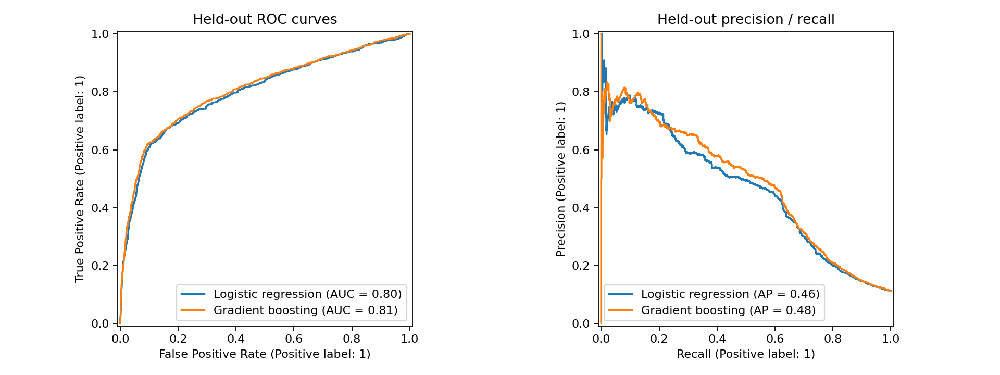

# Bank Marketing · ML & Monitoring

**Predict term-deposit subscriptions, explain model behavior, and inspect changes in input distributions.**

  

**En français :** prédiction de souscription bancaire, comparaison de modèles, explicabilité SHAP et étude de dérive des données. Le parcours exécutable exclut la durée d’appel pour éviter d’utiliser une information indisponible avant l’appel.

[Results](#results) · [Quick start](#quick-start) · [Research notebook](notebooks/bank_marketing_research.ipynb) · [Methodology](docs/methodology.md) · [Related work](docs/related-projects.md)



## Why this project

A strong classification score is only useful when the features are available at prediction time. This project combines a banking use case with class imbalance, preprocessing pipelines, explainability and input-drift analysis. It distinguishes the original academic experiment from a new executable pre-call benchmark.

## Results

Full supplied dataset; stratified 80/20 holdout; seed 42; **`duration` excluded**.

| Model | ROC-AUC | Average precision | F1 at 0.5 |
|---|---:|---:|---:|
| Logistic regression | 0.8008 | 0.4648 | 0.3322 |
| Gradient boosting | 0.8091 | 0.4822 | 0.3506 |

The positive class represents 11.27% of observations. These results were rerun during repository preparation. Machine-readable metrics and the data checksum are available in [reports/validated](reports/validated). The historical notebook contains higher scores with post-call information; see [methodology](docs/methodology.md) for the distinction.

## Quick start

Requires Python 3.11+; download the public dataset with the supplied helper (internet access required).

```bash
python -m venv .venv
# macOS / Linux
source .venv/bin/activate
# Windows PowerShell: .venv\Scripts\Activate.ps1
python -m pip install -r requirements.txt
python src/download_data.py
python src/train.py
```

The command writes metrics, ROC/PR curves, a run manifest and synthetic drift diagnostics to `reports/current/`.

```bash
# Faster check on a stratified subset
python src/train.py --sample 3000
# Explicitly opt into the separate post-call research setting
python src/train.py --include-duration --output reports/post_call
```

For the academic notebook:

```bash
python -m pip install -r requirements-research.txt
jupyter lab notebooks/bank_marketing_research.ipynb
```

The notebook performs many fits and SHAP computations; allow additional runtime.

## Repository guide

| Path | Purpose |
|---|---|
| `src/train.py` | Portable evaluation and drift diagnostics |
| `notebooks/` | Academic study with retained historical outputs |
| `data/` | UCI source documentation, download location and attribution |
| `reports/validated/` | Results from the verified full-data CLI run |
| `docs/methodology.md` | Assumptions, leakage analysis and limitations |

## Data and authorship

[Dataset details](data/README.md) · [Author and preparation changes](AUTHORS.md) · [Reuse notice](NOTICE.md)

**Naoufal Berquecha — CY Tech, Data Science.**
